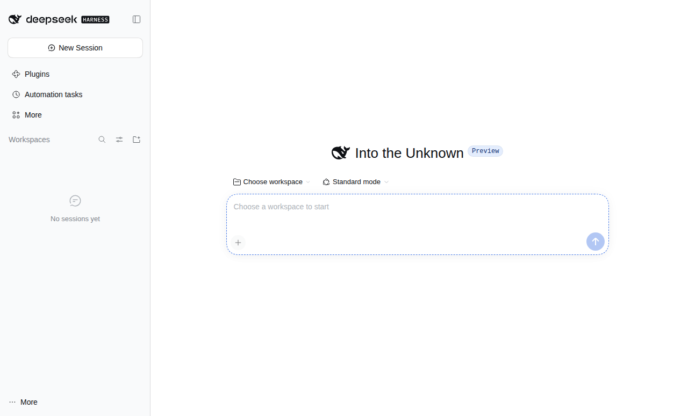

# DeepSeek Harness (Linux)

[](LICENSE)
[](https://github.com/pengchengwanli2024/deepseek-harness-linux/releases/latest)
[](https://github.com/pengchengwanli2024/deepseek-harness-linux/actions/workflows/ci.yml)
[](docs/INSTALL.zh-CN.md)

**Repository**: <https://github.com/pengchengwanli2024/deepseek-harness-linux> · **Upstream**: <https://github.com/deepseek-ai/deepseek-harness>

> **Unofficial Linux desktop build** of DeepSeek Harness, based on the official npm package [`@deepseek-ai/dsh@0.2.1-rc.5`](https://www.npmjs.com/package/@deepseek-ai/dsh).
>
> App version **0.2.1** · bundled dsh **0.2.1-rc.5** · Node.js **24.22.2** · Electron **45.2.1**

This project wraps the DeepSeek Harness web UI into a native Linux desktop application (Electron) and ships it as **AppImage** and **.deb** for x86_64 and arm64. A **CLI installer** is provided for headless servers. The app bundles its own Node.js runtime and dependencies, so system Node.js is not required.

> [!IMPORTANT]
> This is a **community, unofficial** distribution. It is not affiliated with, sponsored by, or endorsed by DeepSeek. "DeepSeek" and "DeepSeek Harness" are trademarks of their respective owners. See [NOTICE.md](NOTICE.md).



## Requirements

- Linux with **glibc ≥ 2.28** (Debian 12+, Ubuntu 22.04+ recommended)
- x86_64 (amd64) or aarch64 (arm64)
- X11, or Wayland via XWayland
- ~0.9–1.1 GB disk after install (download is ~220–270 MB)
- Optional: `libfuse2` (AppImage), `bubblewrap` (command sandbox), `fonts-noto-cjk` (CJK fonts)

## Install

Verify the download first:

```bash
sha256sum -c SHA256SUMS --ignore-missing
```

### AppImage

```bash
chmod +x DeepSeek-Harness-Linux-0.2.1-x86_64.AppImage
./DeepSeek-Harness-Linux-0.2.1-x86_64.AppImage
```

If FUSE is missing: `sudo apt install libfuse2` (Debian 12 / Ubuntu 22.04) or `sudo apt install libfuse2t64` (Ubuntu 24.04+). Without FUSE, prefer `APPIMAGE_EXTRACT_AND_RUN=1 ./DeepSeek-Harness-Linux-0.2.1-x86_64.AppImage`; a manual `--appimage-extract` run needs `--no-sandbox`.

### Debian / Ubuntu package

```bash
sudo apt install ./DeepSeek-Harness-Linux-0.2.1-amd64.deb
deepseek-harness
```

The package name is `deepseek-harness-linux`; the binary is `/usr/bin/deepseek-harness`. The post-install script enables the Electron setuid sandbox. Recommended extras:

```bash
sudo apt install bubblewrap fonts-noto-cjk
```

### Portable tar.gz (optional, build it yourself)

The release ships four packages (AppImage + deb for x86_64 and arm64). A portable tar.gz is not published; build one if needed:

```bash
bash scripts/package/build-linux.sh x64 --targets tar.gz
tar -xzf dist/deepseek-harness-linux-0.2.1-x86_64.tar.gz
cd deepseek-harness-0.2.1-x86_64
./deepseek-harness
```

### CLI installer (servers / no desktop)

```bash
bash scripts/install-cli.sh                     # installs into ~/.local
bash scripts/install-cli.sh --system-node       # reuse a system Node >= 22.19
bash scripts/install-cli.sh --uninstall         # uninstall, keeps user data
```

This provides `dsh-linux` (the full dsh CLI) and `dsh-web` (starts the web UI) in `~/.local/bin`.

## First run

1. Launch the app (menu entry or `deepseek-harness`).
2. Configure an API key: **Settings → Models → DeepSeek → API Key**, or export `DEEPSEEK_API_KEY` before launching, or put it in `$DSH_HOME/.env`.
3. Choose a workspace (default: `~/Documents/deepseek-harness`).
4. Create a session and ask a question to verify tool use.

## Data locations

| Path | Purpose |
| --- | --- |
| `~/.config/deepseek-harness/` | Electron userData (config, `window-state.json`) |
| `~/.config/deepseek-harness/dsh-home/` | Default `DSH_HOME` (profiles, sessions, credentials) |
| `~/.config/deepseek-harness/logs/server.log` | dsh service log (rotates to `server.log.1` at 5 MB) |
| `~/Documents/deepseek-harness/` | Default workspace |

> Running the upstream `dsh` CLI directly uses `~/.dsh` by default; this project's desktop app and `install-cli.sh` both default to `~/.config/deepseek-harness/dsh-home`.

## Update mechanism

- **In-app updates (AppImage only)**: the packaged app checks GitHub Releases silently in the background (about 8 seconds after start), or manually via **Help → Check for Updates…**. When a newer version is found it offers to download and restart to install. Update metadata is published as `latest-linux*.yml` plus blockmap files.
- **deb**: no in-app updater; download the new package from Releases and reinstall (user data is preserved).
- **Upstream tracking**: maintainers' CI checks the upstream `@deepseek-ai/dsh` npm version daily, bumps `versions.json`, builds both architectures and publishes a GitHub Release. See [docs/CI.zh-CN.md](docs/CI.zh-CN.md) (Chinese) and [docs/MAINTAINING.zh-CN.md](docs/MAINTAINING.zh-CN.md).
- Set `DSH_LINUX_DISABLE_UPDATER=1` to disable update checks (offline/test environments).

## Uninstall

```bash
sudo apt remove deepseek-harness-linux        # deb
bash scripts/install-cli.sh --uninstall       # CLI
rm -rf ~/.config/deepseek-harness             # remove user data (irreversible)
```

## Build from source

```bash
git clone https://github.com/pengchengwanli2024/deepseek-harness-linux.git
cd deepseek-harness-linux
```

Requires Docker and Node.js ≥ 22 on the host.

```bash
bash scripts/build.sh                          # x64 + arm64
bash scripts/build.sh --arch x64
bash scripts/build.sh --skip-runtime --arch x64 --targets AppImage
```

Artifacts land in `dist/` together with `SHA256SUMS` and `RELEASE.json`. See [docs/BUILD.zh-CN.md](docs/BUILD.zh-CN.md) (Chinese) for details.

## Documentation

- [docs/INSTALL.zh-CN.md](docs/INSTALL.zh-CN.md) — detailed installation (Chinese)
- [docs/BUILD.zh-CN.md](docs/BUILD.zh-CN.md) — build pipeline (Chinese)
- [docs/FAQ.zh-CN.md](docs/FAQ.zh-CN.md) — troubleshooting FAQ (Chinese)
- [docs/CI.zh-CN.md](docs/CI.zh-CN.md) — CI, release and upstream-tracking pipeline (Chinese)
- [docs/MAINTAINING.zh-CN.md](docs/MAINTAINING.zh-CN.md) — maintainer handbook (Chinese)
- [CHANGELOG.md](CHANGELOG.md) — release history

## Contributing

Contributions are welcome: bug reports, feature requests, documentation fixes, packaging/CI improvements and upstream version bumps.

- [CONTRIBUTING.md](CONTRIBUTING.md) — development setup, build/verify commands, commit and PR rules
- [CODE_OF_CONDUCT.md](CODE_OF_CONDUCT.md) — Contributor Covenant 2.1
- [SECURITY.md](SECURITY.md) — **private** vulnerability reporting
- [docs/MAINTAINING.zh-CN.md](docs/MAINTAINING.zh-CN.md) — release and maintenance handbook

Quick start:

```bash
bash scripts/build.sh --arch x64
bash scripts/test/verify-linux.sh --arch x64 --mode runtime,shell
```

> dsh itself is an upstream project; report upstream issues at <https://github.com/deepseek-ai/deepseek-harness>.

## Security

- Do **not** disclose vulnerability details, API keys, or tokens in public issues.
- Report privately via GitHub Security Advisories: <https://github.com/pengchengwanli2024/deepseek-harness-linux/security/advisories/new>; see [SECURITY.md](SECURITY.md).
- Supported versions: latest release only. Upstream dsh, Node.js and Electron/Chromium issues belong to their respective projects.
- The dsh service binds to `127.0.0.1` with a one-time token URL; AppImage runs Electron with `--no-sandbox` while the .deb keeps the setuid sandbox; logs may contain prompts and local paths — redact before sharing.

## License

Version source: [`versions.json`](versions.json). Project code is [MIT](LICENSE). Upstream DeepSeek Harness is MIT. Bundled Node.js, Electron and third-party dependencies keep their own licenses; see `licenses/` inside the runtime and each npm package. Unofficial/trademark notice: [NOTICE.md](NOTICE.md).

## Known limitations

- Unofficial build; in-app auto-update is AppImage-only (.deb users download new packages manually).
- No tray icon: closing the window quits the app and stops the dsh service.
- The AppImage runs Electron with `--no-sandbox` (setuid sandbox cannot be preserved); use the .deb for a stronger sandbox.
- Wayland runs through XWayland by default; `--ozone-platform=wayland` may be needed on some compositors.
- Official Windows/macOS-only desktop features are not guaranteed to be mirrored on Linux.
